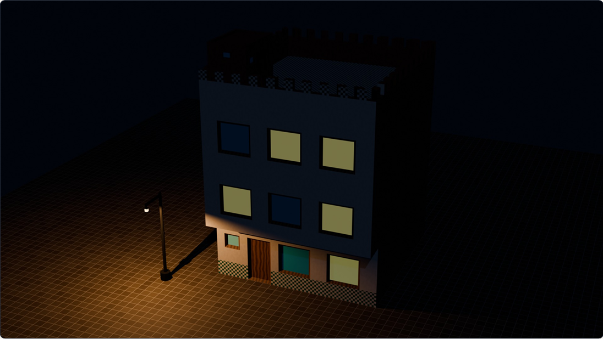
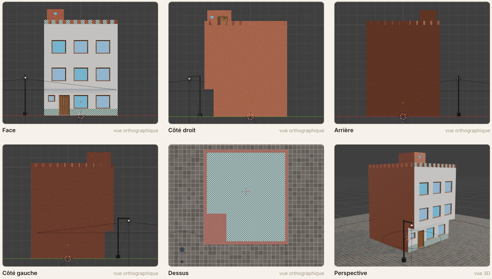
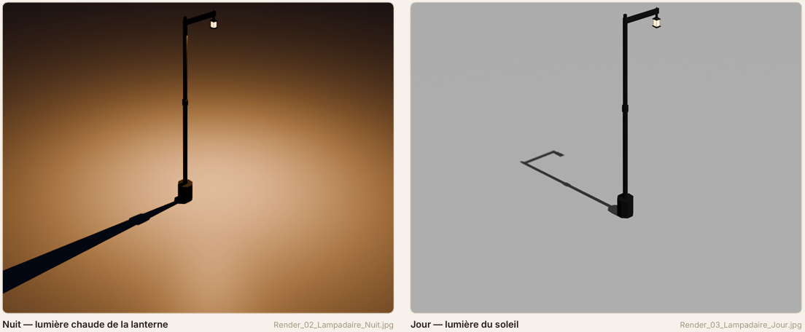
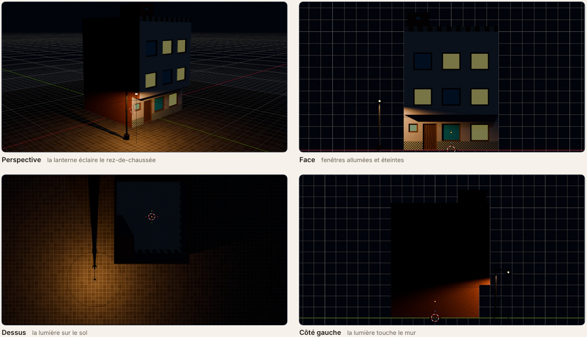

# Moroccan House – Blender

Modélisation 3D d'une maison marocaine traditionnelle et d'un lampadaire, réalisée sous **Blender 5.1**.
Tout le modèle part d'un seul cube et d'un seul cylindre, construits principalement avec **Extrude (E)**,
**Inset (I)** et **Loop Cut (Ctrl R)**.

*Render final – EEVEE, 1920 × 1080 : 3 niveaux, 3 fenêtres par niveau, 1 porte.*

## Vues de la maison

## Lampadaire

Une *Point light* placée sous la lanterne et liée au lampadaire (Parent, Ctrl P) : les deux bougent ensemble.

## Éclairage de nuit

La lanterne donne une lumière chaude ; un *Sun* très faible et bleu joue le rôle de la lune.

## Fichiers

| Fichier | Contenu |
|---|---|
| `scene_finale.blend` | Scène finale : la maison, le lampadaire, les lumières et la caméra |
| `lampe.blend` | Modèle du lampadaire |
| `renders/` | Images du projet |

## Ouvrir le projet

1. Installer [Blender](https://www.blender.org/download/) (version 5.1 ou plus récente).
2. Ouvrir `scene_finale.blend`, puis **F12** pour lancer le rendu.

## Auteur

Ilyas Benderrou – Master « Ingénierie et data analytique appliquée à l'industrie du gaming », ENS Fès.
